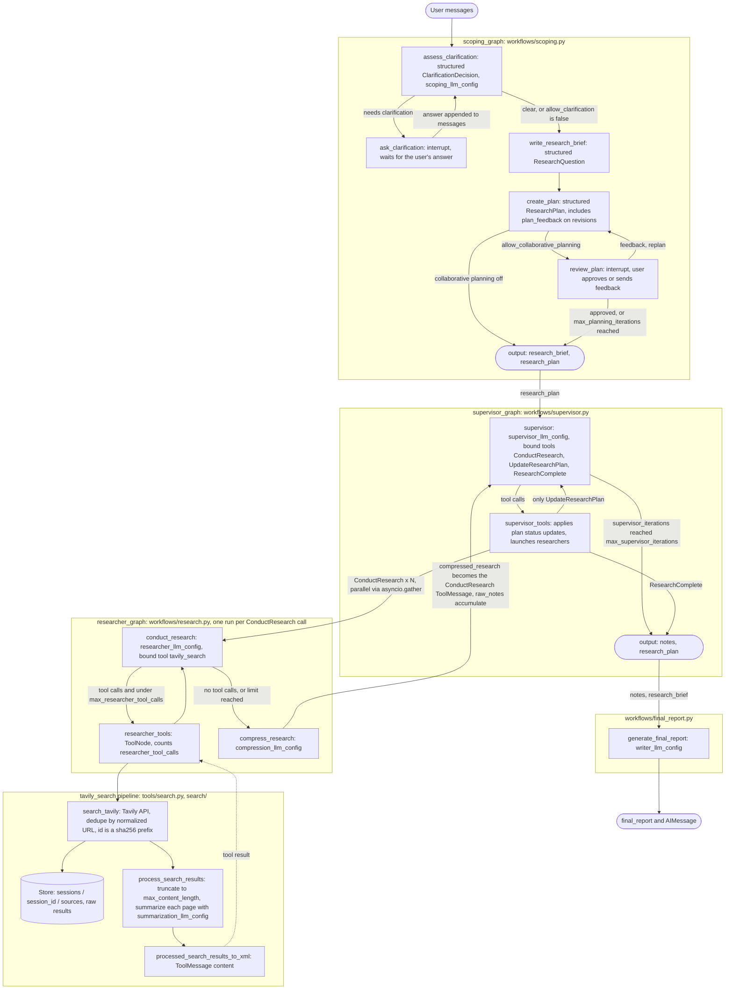

# AGENTS.md

Multi-agent **deep
research** system built on LangGraph. A user question is scoped into a brief and a plan, a supervisor delegates tasks to parallel researchers that search the web, and a writer produces the final report. Python 3.13, managed with `uv`. LLMs are served through OpenRouter, web search through Tavily, and evals and tracing through LangSmith.

## Hard rules (read first)

### 1. Running code

- **The only command you may run
  is `uv run python scripts/check.py`** (ruff + pyrefly on `src` and `evals`). Run it before finishing every task and fix everything it reports.
- **Never run anything else that executes project code.** That includes:
    - `scripts/run_*.py`
    - `python -m evals.run`
    - `evals/ensure_datasets.py`
    - `langgraph dev`
    - ad-hoc `python -c` snippets or REPLs that import `deep_research` or `evals`
- Those paths call paid APIs (OpenRouter, Tavily, LangSmith) and have side effects. If a task needs one, say which command and why, and ask the user to run it and share the output.
- `uv sync` / `uv add` are allowed only when a task requires a dependency change.
- There is no test suite. Correctness comes from `check.py`, careful reading and the user's own runs.
- Never read, print or commit `.env`.

### 2. Documentation and best practices (strict)

This stack changes fast, and the models in `LLMModel` are newer than your training data. **Do not code from memory.**

- Before writing or changing any code that calls a library API, fetch the **current official
  documentation** for it. Covered libraries:
    - LangGraph
    - LangChain (`langchain`, `langchain-core`, `langchain-openrouter`, `langchain-tavily`)
    - LangSmith
    - Tavily
    - OpenRouter
    - Pydantic
    - Rich
    - uv
    - ruff
    - pyrefly
- Source order:
    1. The Context7 MCP (`resolve-library-id`, then `query-docs`).
    2. The official docs site.
    3. The installed package source in `.venv`. Versions are pinned in `uv.lock`, so this is the ground truth for what actually runs.
- If docs and installed source disagree, trust the installed source and tell the user.
- Never guess function signatures, parameters, model IDs, or model capabilities (reasoning effort, structured output, tool calling). Verify model facts on OpenRouter's model pages.
- Prefer official docs and reference pages over blog posts. For any non-trivial API choice, cite the doc URL in your final message.
- If you cannot find authoritative documentation, say so. Do not invent an API.
- Follow current best practices for what you touch (LangGraph state and reducers, `interrupt` and checkpointers, structured output, async I/O, Pydantic v2, ruff and pyrefly guidance). Confirm them in the docs rather than assuming.
- Keep this file accurate. If a change alters the architecture, commands or rules below, update this file in the same change.

### 3. Code conventions (observed in this repo)

- Nodes are `async` functions that return a partial state dict or `Command(goto=..., update=...)`. Routing lives in the nodes, so only fixed edges are declared in the graph builder.
- State is `TypedDict` or `MessagesState` in `state.py`, with reducers (`operator.add`, `add_messages`) on fan-in fields. Each graph has separate input and output schemas.
- Structured LLM output uses `FrozenBaseModel` subclasses from `schemas.py`, created through `init_openrouter_structured_model`.
- Models are the `LLMModel` enum in `configuration.py`. Add new models there and never hardcode model strings. Per-role settings live in `Configuration`.
- Prompts are `str.format` templates in `prompts/`, one module per workflow. **Escape literal braces as `{{` and `}}`.**
- Docstrings are Google style (`Args:` / `Returns:`). Keep existing comments and docstrings that are unrelated to your change.
- Do not add `# pyrefly: ignore` without a reason. Existing ones work around LangGraph TypedDict typing.
- `studio.py` compiles graphs at import time. Graph builders must have no import-time side effects, and `checkpointer` / `store` are passed in as arguments.
- Commits follow `.github/git-commit-instructions.md` (Conventional Commits).

### 4. Engineering learning notebook (`NOTES.md`)

- `NOTES.md` is a persistent engineering notebook across sessions where the user is the learner, and you act as an expert teacher/mentor.
- Whenever a discussion, design review, or debugging task surfaces a **non-obvious architectural pattern, production failure mode, prompt-engineering principle, or framework/runtime
  gotcha** that goes beyond the user's existing baseline, collaboratively record it in `NOTES.md` with user's approval.
- Before adding an entry, read `NOTES.md` to check the **Developer Baseline (What NOT to Add)** and existing notes. Write every new entry so it is completely self-contained for future contextless sessions using the file's `Context / Problem` $\rightarrow$ `Principle / Solution` $\rightarrow$ `Reasoning / Trade-offs` format.

## System flow

`deep_research` (`workflows/deep_research.py`) chains `scoping_graph`, `supervisor_graph` and `generate_final_report`. It uses `AgentState` and takes only `messages` as input. `scoping_graph`, `supervisor_graph` and `researcher_graph` are also exported on their own through `studio.py` and `langgraph.json`.

### Config roles (`Configuration` in `configuration.py`)

| Config                     | Used by                                                       |
|----------------------------|---------------------------------------------------------------|
| `scoping_llm_config`       | `assess_clarification`, `write_research_brief`, `create_plan` |
| `supervisor_llm_config`    | `supervisor`                                                  |
| `researcher_llm_config`    | `conduct_research`                                            |
| `summarization_llm_config` | page summaries inside `tavily_search`                         |
| `compression_llm_config`   | `compress_research`                                           |
| `writer_llm_config`        | `generate_final_report`                                       |

Loop and size limits are `max_planning_iterations`, `max_supervisor_iterations`, `max_researcher_tool_calls`, `max_concurrent_research_threads`, `max_structured_output_retries` and `max_content_length`. Their current values are in `configuration.py`.

## Layout

- `src/deep_research/`
    - `workflows/`: graph builders and nodes (`scoping`, `supervisor`, `research`, `final_report`, `deep_research`).
    - `prompts/`: one prompt module per workflow.
    - `tools/`: LLM-callable tools (`search.py`, `supervisor.py`, `reflection.py`).
    - `search/`: Tavily client and result processing.
    - `memory/`: source storage helpers.
    - `state.py`, `schemas.py`, `formatting.py` (XML rendering for prompts), `openrouter.py` (model factories), `configuration.py`, `studio.py`.
- `scripts/`: manual runners (human use only) plus `check.py`.
- `evals/<suite>/`: LangSmith datasets, targets and evaluators, with data in `data/*.jsonl`. Suites are `brief`, `plan` (both in `scoping`), `research`, `supervisor` and `final_report`. Register new suites in `evals/run.py`.
- `NOTES.md`: persistent cross-session engineering learning notebook maintained by agents.

## Gotchas

- `Configuration.from_runnable_config` requires `configurable.thread_id`. It also provides `session_id` for the Store namespace and OpenRouter session tagging. Other fields resolve from `configurable` first, then from an env var named after the uppercased field, then from the class default.
- `tavily_search` raises if `runtime.store` is `None`, so any caller must provide a Store.
- `search/tavily.py` creates `AsyncTavilyClient()` at import time, which needs `TAVILY_API_KEY` in the environment.
- `max_concurrent_research_threads` is passed to the supervisor prompt but not enforced in code (TODO in `supervisor_tools`).
- `think_tool` (`tools/reflection.py`) is defined but not currently bound to any agent.
- Interrupts (`ask_clarification`, `review_plan`) need a checkpointer. `scoping_graph` in `studio.py` is compiled with `checkpointer=None`, which LangGraph Studio replaces at runtime.
